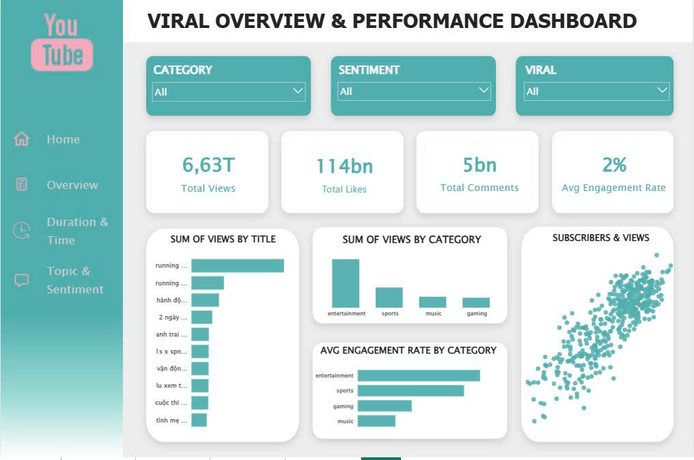
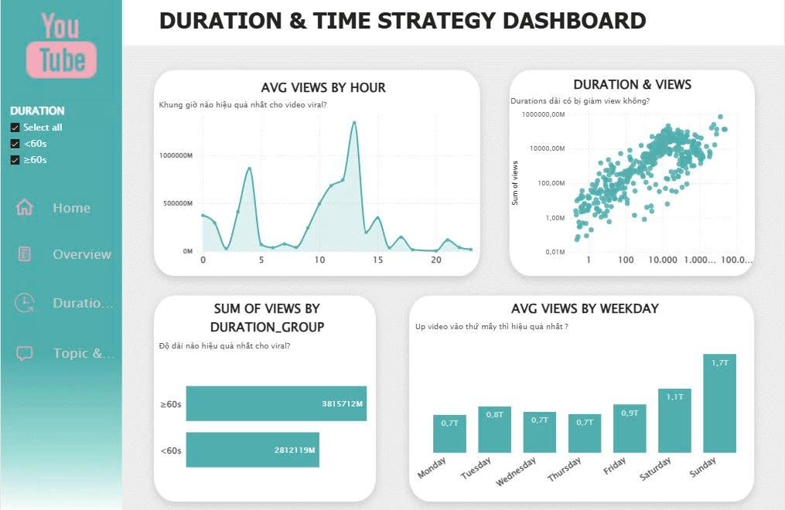
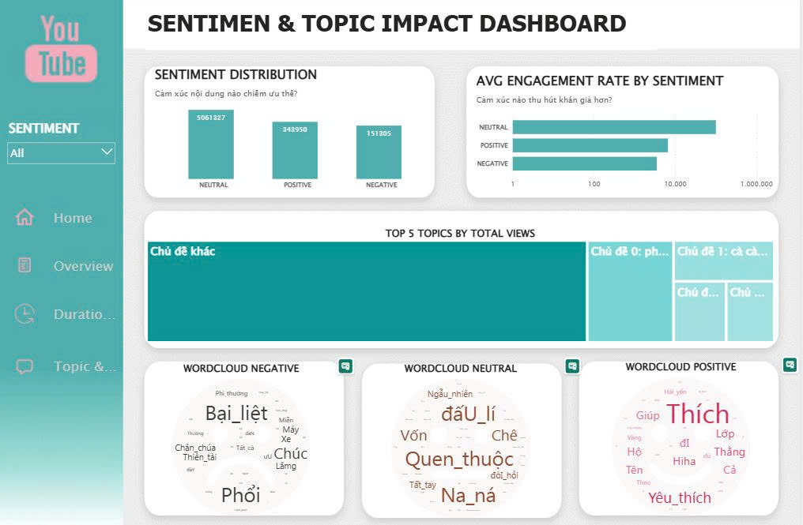

# youtube-shorts-trend-analysis
Analyzed 7,242 YouTube Shorts videos using Python, NLP (PhoBERT, BERTopic) and Power BI to identify viral content factors and engagement drivers.

# YouTube Trending Vietnam – Phân tích xu hướng video ngắn & yếu tố viral

Pipeline phân tích end-to-end: thu thập dữ liệu qua **YouTube Data API v3** → làm sạch & xử lý tiếng Việt (NLP) → **Sentiment Analysis**, **Topic Modeling**, **Engagement Analysis** → dashboard **Power BI**.

**Câu hỏi chính:** Những yếu tố nào (độ dài video, thời điểm đăng, chủ đề, cảm xúc nội dung) liên quan đến việc video đạt lượt xem/tương tác cao trên YouTube Việt Nam?

---

## Mục tiêu

- Xác định đặc điểm chung của video viral (`views` thuộc top 10%).
- Đo lường mối quan hệ giữa độ dài, thời điểm đăng, category, cảm xúc, chủ đề với views và engagement.
- Đề xuất định hướng nội dung cho creator.

## Dữ liệu

| Thông tin | Chi tiết |
|---|---|
| Nguồn | YouTube Data API v3 (`videos().list()`, `channels().list()`), mục Trending Việt Nam |
| Thời điểm | Snapshot ngày 01/11/2025 |
| Quy mô | 500 video → **471 video** sau làm sạch |
| Trường dữ liệu | `video_id`, `title`, `hashtags`, `channel`, `subscribers`, `views`, `likes`, `comments`, `category`, `published_at`, `duration`, `top_comments` (top 50 bình luận/video) |
| Ngôn ngữ | Tiếng Việt |

> Dữ liệu chỉ phục vụ mục đích học tập, thu thập qua API chính thức và tuân thủ hạn mức truy cập của Google.

## Quy trình

````
YouTube API ──► Preprocessing ──► NLP (comments) ──► SA / TM / EA ──► Power BI
````

**1. Tiền xử lý**
- Điền giá trị thiếu (`title`, `hashtags`, `top_comments`), chuẩn hóa text (lowercase, strip), chuẩn hóa `published_at`.
- Lọc bot/spam: loại video có `subscribers` ≤ 10 hoặc `views`/`likes`/`comments` = 0.
- Tạo `engagement_rate = (likes + comments) / views`.

**2. Xử lý bình luận tiếng Việt**
- Tách `top_comments` thành từng dòng (`explode`), chuyển emoji thành từ, chuẩn hóa từ viết tắt/slang.
- Tokenize bằng **VnCoreNLP** (word segmentation), ghép cụm từ bằng **Aho-Corasick** với từ điển **Viet74K**.
- Lọc bản ghi nhiễu: bỏ bình luận < 2 từ, toàn số, hoặc < 50% token có trong từ điển.

**3. Phân tích**

| Hướng | Phương pháp | Output |
|---|---|---|
| Sentiment Analysis | `cardiffnlp/twitter-roberta-base-sentiment-latest` (xác suất) + ngưỡng tối ưu hóa theo bộ keyword | POSITIVE / NEUTRAL / NEGATIVE |
| Topic Modeling | **BERTopic** (BERT embedding + HDBSCAN), so sánh với **LDA** (10 topics) | Nhóm chủ đề, cụm nhiễu (-1) |
| Engagement Analysis | Descriptive statistics theo `category` | Engagement/like/comment rate, subs per 1K views |

**4. Feature engineering cho dashboard:** `duration_group` (<60s / ≥60s), `is_viral` (views > percentile 90), `publish_hour`, `publish_weekday`, `publish_month`.

## Dashboard (Power BI)

### Viral Overview & Performance


### Duration & Time Strategy


### Sentiment & Topic Impact


## Một số phát hiện

- **Category:** Entertainment dẫn đầu về tổng views và engagement rate trung bình, tiếp theo là Sports, Gaming, Music.
- **Thời điểm đăng:** Lượt xem trung bình cao hơn rõ rệt vào **cuối tuần** (cao nhất Chủ nhật); theo giờ có hai đỉnh quanh **~4h sáng** và **~10–13h**.
- **Độ dài:** Scatter plot không cho thấy quan hệ tuyến tính rõ ràng giữa duration và views.
- **Cảm xúc:** Phần lớn nội dung ở nhóm Neutral.
- **Chủ đề:** BERTopic tạo một cụm nhiễu lớn ("Chủ đề khác") cùng các cụm nhỏ phân tán; LDA cho cụm rộng và trùng từ khóa hơn.

## Hạn chế

- Mẫu nhỏ (471 video) và chỉ là một snapshot trending → dễ chịu ảnh hưởng bởi sự kiện/mùa vụ, không suy ra quan hệ nhân quả.
- Mô hình sentiment là RoBERTa tiếng Anh áp dụng lên tiếng Việt; nhãn tham chiếu để tối ưu ngưỡng được tạo từ keyword, chưa được gán nhãn thủ công → cần kiểm chứng trước khi dùng.
- Tập dữ liệu là video trending (có cả video ≥ 60s), không chỉ riêng YouTube Shorts.
- Một số nhóm (ví dụ Music) có ít video nên chỉ số kém ổn định.

**Hướng cải thiện:** dùng PhoBERT cho sentiment, gán nhãn thủ công một tập mẫu để đánh giá, thu thập dữ liệu nhiều thời điểm.

## Tech stack

`Python` · `pandas` · `scikit-learn` · `transformers` · `BERTopic` · `VnCoreNLP` · `pyahocorasick` · `emoji` · `Google API Client` · `Google Colab` · `Power BI`

## Cấu trúc repo

```
├── images/
│   ├── overview.jpg
│   ├── duration.jpg
│   └── topic.jpg
├── Youtube_Shorts_Trend_Analysis.ipynb
├── YOUTUBE_GOC.csv
├── Youtube_Shorts_Dashboard.pbix
├── Slide_Youtube_Shorts_Trend_Analysis.pptx
└── README.md
```


## Chạy lại

````bash
pip install pandas emoji vncorenlp pyahocorasick transformers torch scikit-learn bertopic umap-learn hdbscan gensim
````
Mở notebook trên Google Colab; cần thêm `VnCoreNLP-1.2` và `Viet74K.txt` để chạy bước tokenize.

## Tác giả

**Đoàn Thị Kim Ánh** [doankimanh716@gmail.com] – Data Analyst hướng tới AI/ML Engineer · [GitHub]([https://github.com/](https://github.com/AnhDoan714/youtube-shorts-trend-analysis.git)) 
````
````

